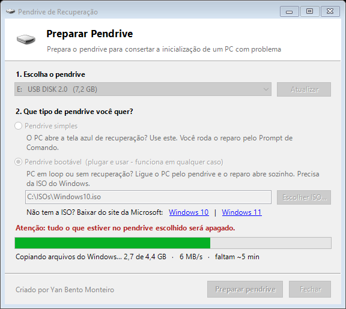
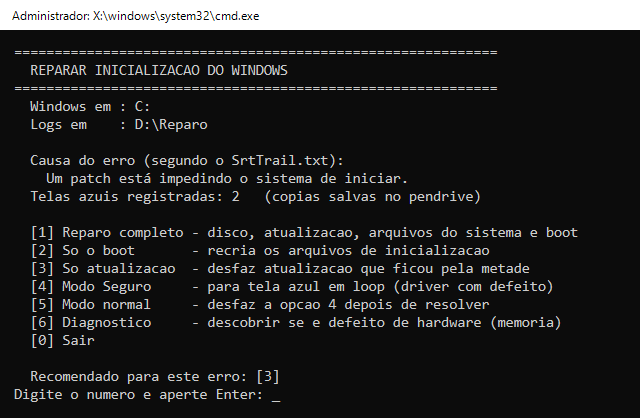
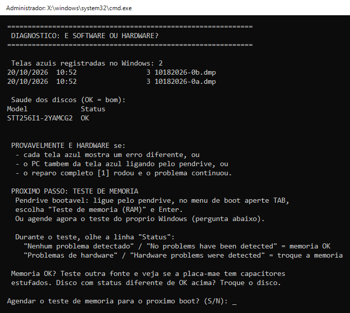
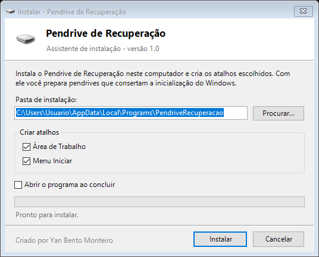

# Pendrive de Recuperação

Prepara um pendrive que conserta a inicialização do Windows 10/11: erro `SrtTrail.txt`, tela azul em loop, boot corrompido, atualização travada. Também mostra quando o problema é defeito de hardware.

**Criado por Yan Bento Monteiro**

<p align="center">
  
</p>

## Por que existe

Quando o Windows não liga, o técnico costuma entrar no Prompt de Comando da recuperação e digitar à mão `chkdsk`, `sfc`, `bootrec`, `bcdboot`... e torcer para acertar a letra do disco. Este projeto junta tudo num pendrive:

- **Plugar e usar:** o pendrive bootável abre o menu de reparo sozinho, sem precisar digitar nada;
- **Lê a causa do erro** no `SrtTrail.txt` e recomenda a opção certa;
- **Acha sozinho a letra do Windows** no ambiente de recuperação (que quase nunca é `C:`);
- **Usa os comandos certos para o ambiente de recuperação:** `sfc /scannow` sozinho verifica o próprio ambiente e não o Windows do PC;
- **Mostra quando é hardware:** teste de memória no menu de boot e diagnóstico das telas azuis.

## Download

Na página **[Releases](../../releases)**:

| Arquivo | Uso |
|---|---|
| `PendriveDeRecuperacao.exe` | Portátil: dois cliques e usa, sem instalar |
| `Instalar-PendriveDeRecuperacao.exe` | Instala no PC com atalhos na Área de Trabalho e no Menu Iniciar |

Funciona em Windows 10/11 de 32 e 64 bits. Pede administrador, que é necessário para formatar o pendrive.

## Tipos de pendrive

**Pendrive simples:** para quando o PC ainda abre a tela azul de recuperação.
No PC: *Solução de Problemas → Opções avançadas → Prompt de Comando* e digite `D:\RepararInicializacao.bat` (se não achar, tente `E:`, `F:`...).

**Pendrive bootável (plugar e usar):** para quando o PC fica em loop ou não abre a recuperação. Precisa da ISO do Windows; os links de download estão na própria janela.
No PC: ligue apertando a tecla do menu de boot (F12, F11, F8 ou Esc) e escolha o pendrive. O menu de reparo abre sozinho.
No menu de boot, **TAB → "Teste de memoria (RAM)"** testa a memória sem depender do Windows.

## Menu de reparo

| Opção | O que faz |
|---|---|
| **[1] Reparo completo** | `chkdsk /f /r`, desfaz atualização pendente, `sfc` offline e reparo do boot |
| **[2] Só o boot** | `bootrec /fixmbr`, `/fixboot`, `bcdboot`, `bootrec /rebuildbcd` |
| **[3] Só atualização** | `DISM /RevertPendingActions` |
| **[4] Modo Seguro** | Para tela azul causada por driver com defeito |
| **[5] Modo normal** | Desfaz a opção 4 |
| **[6] Diagnóstico** | Conta as telas azuis, verifica os discos e agenda o teste de memória |

<p align="center">
  
</p>

O script lê o `SrtTrail.txt`, mostra a causa do erro e recomenda a opção certa. Logs, cópia de segurança do boot (BCD) e as telas azuis registradas (`Minidump`) ficam salvos no pendrive.

## É hardware?

Sinais: cada tela azul mostra um erro diferente, o PC trava até ligando pelo pendrive, ou o reparo completo não resolveu. Nesses casos nenhum reparo de software resolve: rode o teste de memória e verifique fonte e placa-mãe.

<p align="center">
  
</p>

## Instalador

Além da versão portátil, há um instalador que cria atalhos e aparece em *Configurações → Aplicativos* para desinstalar.

<p align="center">
  
</p>

## Estrutura

```
src/
  PrepararPendrive.ps1      janela principal (formata e prepara o pendrive)
  Instalador.ps1            instalador / desinstalador
  RepararInicializacao.bat  menu de reparo (roda no ambiente de recuperação)
  ColetarInicializacao.bat  coleta itens de inicialização (diagnóstico)
  launcher/                 executáveis em C# que embutem e rodam os scripts
build.ps1                   gera os .exe em dist/
```

## Gerar os executáveis

```powershell
powershell -ExecutionPolicy Bypass -File build.ps1
```

Usa o compilador C# que já vem no Windows (.NET Framework 4); não precisa instalar nada. O build também confere a sintaxe e corrige a codificação dos arquivos: `.ps1` em UTF-8 com BOM e `.bat` em CRLF.
